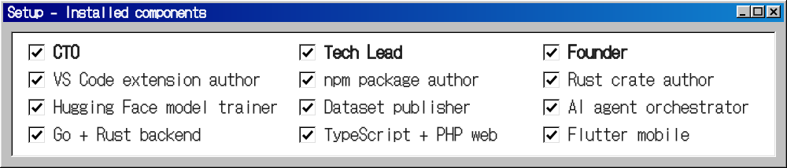
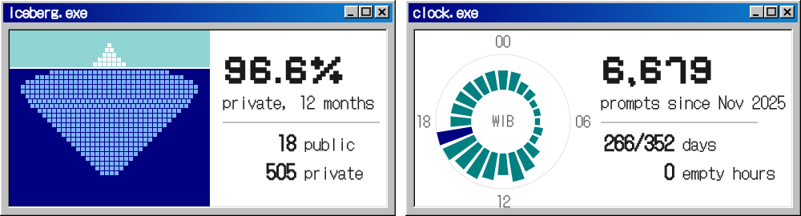
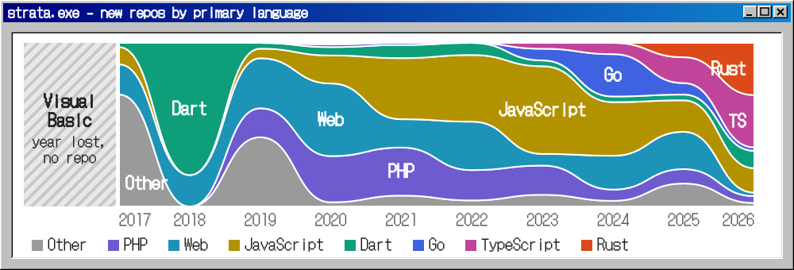

  

  <a href="https://marketplace.visualstudio.com/publishers/aibnuhibban">VS Code</a> &nbsp;&nbsp;
  <a href="https://huggingface.co/AIbnuHibban">Hugging Face</a> &nbsp;&nbsp;
  <a href="https://www.npmjs.com/~aibnuhibban">npm</a> &nbsp;&nbsp;
  <a href="https://crates.io/users/AIbnuHIbban">crates.io</a> &nbsp;&nbsp;
  <a href="https://dev.to/aibnuhibban">dev.to</a>

| VS Code | Installs | Libraries & models | Reach |
|---|--:|---|--:|
| [CodeIgniter Spark](https://marketplace.visualstudio.com/items?itemName=aibnuhibban.codeigniter-spark) | 35,222 | [ByteDocs](https://bytedocs.dev) | 9 stacks |
| [Laravel Smart Command](https://marketplace.visualstudio.com/items?itemName=aibnuhibban.laravel-smart-command) | 10,652 | [IndoPII](https://huggingface.co/spaces/AIbnuHibban/indopii) | 0.930 F1 |
| [Lumen Smart Command](https://marketplace.visualstudio.com/items?itemName=aibnuhibban.lumen-smart-command) | 7,440 | [GLiNER2.5 Indonesian](https://huggingface.co/spaces/AIbnuHibban/gliner2.5-indonesian-extractor) | 0.862 F1 |
| [Laravel Full Extension Pack](https://marketplace.visualstudio.com/items?itemName=aibnuhibban.laravel-full-extension-pack) | 6,619 | [E-commerce sentiment](https://huggingface.co/datasets/AIbnuHibban/e-commerce-sentiment-bahasa-indonesia) | 21,840 rows |

<code>$ cat strata.csv</code>

 

| Year | Other | PHP | Web | JavaScript | Dart | Go | TypeScript | Rust |
|---|--:|--:|--:|--:|--:|--:|--:|--:|
| 2017 | 26 | 0 | 7 | 4 | 1 | 0 | 0 | 0 |
| 2018 | 0 | 0 | 5 | 0 | 21 | 0 | 0 | 0 |
| 2019 | 36 | 15 | 26 | 5 | 3 | 0 | 0 | 0 |
| 2020 | 3 | 33 | 52 | 20 | 6 | 2 | 1 | 0 |
| 2021 | 5 | 22 | 13 | 28 | 6 | 1 | 0 | 0 |
| 2022 | 1 | 5 | 8 | 11 | 2 | 0 | 0 | 0 |
| 2023 | 2 | 5 | 2 | 15 | 1 | 2 | 1 | 0 |
| 2024 | 2 | 4 | 12 | 19 | 2 | 15 | 4 | 0 |
| 2025 | 8 | 5 | 13 | 11 | 2 | 4 | 9 | 5 |
| 2026 | 1 | 2 | 1 | 7 | 5 | 1 | 15 | 15 |

<code>$ ls ~/writing</code>

 

<!-- BLOG-POST-LIST:START -->
- [Create Your Own Lumen Installer (2020)](https://dev.to/aibnuhibban/create-your-own-lumen-installer-2020-10p8)
- [Membuat Lumen Installer Sendiri (2020)](https://dev.to/aibnuhibban/membuat-lumen-installer-sendiri-2020-4nbn)
- [Login Customization in Laravel 8](https://dev.to/aibnuhibban/login-customization-in-laravel-8-2gc8)
- [Kustomisasi Login di Laravel 8 (2020)](https://dev.to/aibnuhibban/kustomisasi-login-di-laravel-8-1jin)
- [Konfigurasi Email di Lumen 7  (2020)](https://dev.to/aibnuhibban/konfigurasi-email-di-lumen-7-2020-g1e)
<!-- BLOG-POST-LIST:END -->

